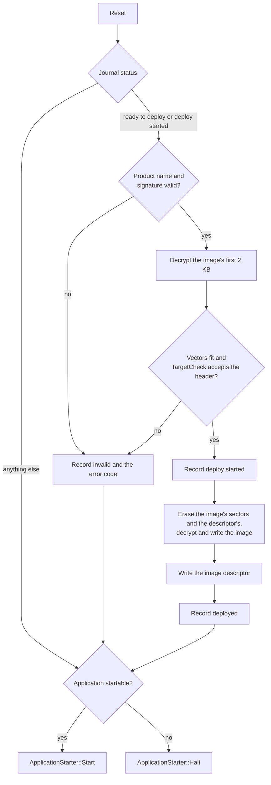

# Bootloader

## Introduction

The `upgrade/boot_loader` package reads an upgrade pack, verifies its signature and hands each image to an image upgrader.
The `bootloader` package builds a single-stage bootloader on top of it: one program at the start of flash that installs a pack staged by the application into the application slot, and starts the application only when the slot holds an intact image built for the chip it runs on.

It adds four things the pack components leave to the product:

- a **status journal**, so the installation's progress survives resets on flash that cannot program a unit twice;
- an **application header** and an **image descriptor**, so an image says what it was built for and the slot proves it is complete;
- an **application installer** that checks the image against the target before anything is erased;
- a **boot sequence** that ties these together at every reset.

Everything is synchronous, uses no heap and no event dispatcher, and runs against `hal::SynchronousFlash`, so the whole install path is tested on the host against a flash fake.

## Boot sequence



- The signature and the target are checked before anything is erased, so a pack that fails either leaves the old application in place.
- An installation interrupted by a reset finds the journal at *deploy started* and starts over; the copy only reads the staging flash, so it can be repeated as often as it takes.
- A flash error during the copy is recorded as *invalid*; the slot is then incomplete and the application is not started.

## Status journal

`bootloader::StatusJournal` keeps the `application::UpgradePackStatus` and error code of the staged pack in a flash region of its own, instead of in the pack's status byte, which the pack loader clears bit by bit and which flash with ECC-protected program units cannot do.

| Offset | Size | Field                                       |
|--------|------|---------------------------------------------|
| 0      | 4    | marker `0x314a4d45` (`EMJ1`)                |
| 4      | 1    | status, as `application::UpgradePackStatus` |
| 5      | 3    | reserved, `0xff`                            |
| 8      | 4    | error code                                  |
| 12     | 4    | check, `~(marker ^ status ^ errorCode)`     |

- Each 16-byte entry goes into the next erased unit; the current status is the last valid entry, and an erased journal reads *empty*.
- An entry a reset cut short fails its check and is skipped, so no unit is ever programmed twice.
- A status and error code equal to the current ones are not written again.
- A full journal is erased and restarted with the status being recorded.

The application starts a download by erasing the journal (`Clear()`), records *downloaded* once the pack passed its checks and *ready to deploy* when the user applies it.
`JournalPackLoader` and `JournalPackUpgrader` replace the status operations of `application::UpgradePackLoader` and `application::PackUpgrader` with the journal.

## Application header and image descriptor

`ImageFormat.hpp` defines what an image carries:

- `TargetLayout`: the chip's RAM and the application slot.
- `ApplicationHeader`: 64 bytes at offset `applicationHeaderOffset` (1 KB) from the start of the image, past the vector table of every supported Cortex-M.

  | Offset | Size | Field                                 |
  |--------|------|---------------------------------------|
  | 0      | 4    | magic `0x48414d45` (`EMAH`)           |
  | 4      | 2    | header version, 1                     |
  | 6      | 2    | reserved, `0xff`                      |
  | 8      | 6    | firmware version: major, minor, patch |
  | 14     | 2    | reserved, `0xff`                      |
  | 16     | 48   | target, defined by the product        |

- `ImageDescriptor`: the last 64 bytes of the slot: magic `0x44494d45` (`EMID`), the image size and the SHA-256 of that many bytes from the start of the slot.

The library never interprets the target area: what an image was built for, a board, a chip family, a device identity or anything else, is the product's to define.
The product describes it as a trivially copyable struct of at most 48 bytes; `MakeApplicationHeader(target, major, minor, patch)` builds the header at compile time with the struct at the start of the target area and the rest erased, so the header comes from the same definitions as the code beside it, and `TargetOf<Target>(header)` reads the struct back.

The product decides whether an image is for this target through `bootloader::TargetCheck`, whose `Accepts(header)` it implements, for example from the chip's identity register read at that moment.
`ExactTargetCheck<Target>` is the common case: it accepts a header whose target equals the one it was given.

```cpp
struct Target
{
    uint16_t board;
    uint16_t family;
    uint32_t device;

    bool operator==(const Target& other) const = default;
};

const bootloader::ExactTargetCheck<Target> targetCheck{ Target{ boardKind, familyTag, ReadDeviceIdentity() } };
```

`ApplicationCheck.hpp` checks an image with it:

- `ImageStartFitsTarget` takes the start of an image: the initial stack pointer lies in RAM, the reset handler is a Thumb address in the slot, the header's magic and version are valid, and the target check accepts the header. Images for chips whose flash or RAM lie elsewhere fail on the vectors alone.
- `ApplicationIsStartable` takes the whole slot: the descriptor is valid, its SHA-256 matches the image, and the image start fits the target.
- `MakeImageDescriptor` computes the descriptor of an image, for tools that program a slot directly.

## Application installer

`bootloader::ApplicationInstaller` is the `application::ImageUpgrader` for the image named `app`. It refuses, before any erase:

| Error code              | Value | When                                                                              |
|-------------------------|-------|-----------------------------------------------------------------------------------|
| `errorWrongDestination` | 1001  | the image's destination is not the start of the slot                              |
| `errorImageSize`        | 1002  | the image is shorter than its header or does not fit the slot less its descriptor |
| `errorWrongTarget`      | 1000  | the decrypted first 2 KB fail `ImageStartFitsTarget`                              |

The values lie outside 0–999, which `UpgradePackHeader.hpp` reserves for the reference boot loaders. AES-128-CTR decrypts any part of the stream on its own, so the target check uses a second decryptor and costs nothing in the copy that follows.
The installer then erases the sectors the image spans and the descriptor's sector, decrypts and writes the image, and writes the descriptor from a SHA-256 of what it reads back from the slot.

## Staging a pack from the application

The application, not the bootloader, writes the pack into the staging flash, usually while it keeps running. `upgrade/staging` holds the asynchronous pieces for that, on `hal::Flash` and the event dispatcher:

- `PackStagingWriter` erases the staging flash and checks that every sector reads back blank, then takes the pack in appends of at most eight bytes, programs it a page at a time and reads each page back before reporting it written. `Flush` programs a final partial page.
- `StagedPackReader` computes the CRC-32 of the staged bytes and reads the pack header back: the prologue, the epilogue after the signature and the first image's prologue, each only when it lies within the staged length.
- `CheckStagedPackHeader` refuses a pack the bootloader would refuse or could not install: wrong magic or header version, another product, more than one image, another target, an image larger than the target slot or not ending the pack. It returns the pack's `major.minor.patch` product version, so an application can report what it staged.

Both classes take a `proceed` predicate that is consulted after every flash step. When it returns false the operation ends without calling back, which lets an application abandon staging (for example on an emergency stop) without waiting for the flash. Neither needs a page buffer larger than 256 bytes or any heap.

## Wiring

The product supplies the flash drivers, the keys (see [Keys](#keys)), its `TargetCheck` and an `ApplicationStarter`, which jumps to the application or halts.
On a Cortex-M, `hal::cortex::JumpToApplication(slotBegin)` (`hal/cortex_m/JumpToApplication.hpp`) does the jump: it points VTOR at the application's vector table, loads the main stack pointer from its first entry and branches to the reset handler in the second.

```cpp
bootloader::StatusJournal journal{ journalFlash };
application::DecryptorAesTiny decryptor{ aesKey };
application::DecryptorAesTiny checkDecryptor{ aesKey };
const application::VerifierEcDsa256 verifier{ publicKey };
std::array<uint8_t, bootloader::imageStartCheckSize> buffer{};

bootloader::ApplicationInstaller installer{ decryptor, checkDecryptor, slotFlash, layout, targetCheck, infra::MakeRange(buffer) };

bootloader::BootSequence{ { packFlash, journal, installer, decryptor, verifier, "product name", slotMemory, layout, targetCheck, starter } }.Run();
```

`slotMemory` is the application slot as memory-mapped bytes, for the check at every reset; `slotFlash` is the same region as a `hal::SynchronousFlash`, with addresses relative to the slot's start.

## Keys

The bootloader verifies packs with an ECDSA-P256 public key and decrypts their images with an AES-128 key.
A product keeps them out of its sources: the bootloader links a `bootloader::KeySlot` (`KeySlot.hpp`), the public key and then the image key, 80 bytes, erased (`ErasedKeySlot()`) in a section of its own.
The keys are not a build input: once the build is done, `application.bootloader_image inject-keys` writes them into that section of the linked bootloader and into its Intel HEX files.
The build is the same with any key set or none, and one build can take the development set or the release set.
An erased slot holds no valid public key, and `VerifierEcDsa` refuses every signature under a key that is not on the curve, so a bootloader built without keys installs no pack and only starts the application already in the slot.

A key set is the file the keys come from, 112 bytes:

| Offset | Size | Field                                       |
|--------|------|---------------------------------------------|
| 0      | 16   | AES-128 image key                           |
| 16     | 64   | ECDSA-P256 public key, x then y, big-endian |
| 80     | 32   | ECDSA-P256 private key, big-endian          |

It holds the private key that signs packs, so it is secret: a product keeps it outside its repository, for example as a CI secret, and keeps a separate set for development and for release.

## Image tool

`application.bootloader_image` is a host tool for the files around an image:

| Command                                                                           | Writes                                                                                           |
|-----------------------------------------------------------------------------------|--------------------------------------------------------------------------------------------------|
| `generate-keys --output <file>`                                                   | a new key set; never overwrites a file, and the file is readable by its owner only               |
| `bootloader-keys --keys <key set> --output <file>`                                | the key slot of a key set                                                                        |
| `descriptor --image <binary> --output <file>`                                     | the image descriptor of an image, computed with `MakeImageDescriptor`                            |
| `combine --output <file> <bootloader hex> <application hex>`                      | one Intel HEX file with the bootloader's records and then the application's, for a debugger      |
| `inject-keys --keys <key set> --elf <file> [--hex <file>]...`                     | the key slot into the bootloader's ELF file, and at that address into every HEX file given       |
| `pack --keys <key set> --image <binary> --destination <address> --product <name>` | an upgrade pack of one `app` image, encrypted with the image key and signed with the private key |

`inject-keys` finds the slot by section name (`.bootloader_keys`, or `--section`), checks that it is 80 bytes and writes it at the section's load address into each HEX file, such as the bootloader's own and a combined image.
It changes no file unless every one of them takes the slot.

`pack` builds the pack `BootSequence` installs with the upgrade pack builder (`UpgradePackBuilder`, `ImageEncryptorAes` and `ImageSignerEcDsa256` in `upgrade/pack_builder`, wired by `BuildPack` in `application/bootloader_image/Pack.hpp`): one `app` image, AES-128-CTR with a random initial counter, an ECDSA-P256 signature over the header and the image, and the product name the bootloader checks.
The destination is the address the image is written to, the start of the application slot; `--product-version` and `--component` fill the header's other names.
A name longer than its 63-character field is refused rather than cut. The bootloader package's own tests build their packs with the same function, so the format the tool writes is the one the boot sequence accepts.

`cmake/emil_bootloader_image.cmake` runs the tool as post-build steps, with `EMIL_OBJ_COPY_TOOL`:

- `emil_fetch_bootloader_image()` makes the tool a target of the build; a cross-compiling build builds it at `_native_bootloader_image/bin` in its build directory, where a later `inject-keys` finds it.
- `emil_bootloader_image_descriptor(<target> [SECTION <section>])` writes the descriptor into the linked application (default section `.image_descriptor`). The descriptor covers the image as a debugger programs it: every section but the descriptor's, gaps erased, from the first section, which starts at the start of the slot.
- `emil_bootloader_combined_hex(<name> OUTPUT <file> BOOTLOADER <target> APPLICATION <target>)` adds a target that joins the two `.hex` files `emil_generate_artifacts` writes.

The descriptor step must come before `emil_generate_artifacts`, so the `.bin` and `.hex` files carry the descriptor. A cross-compiling build has no host tools of its own; `emil_native_executables` (`cmake/emil_native_executables.cmake`) builds the tool with the host's compiler, in a directory of its own, and imports it, as it does for the ECHO compilers.
