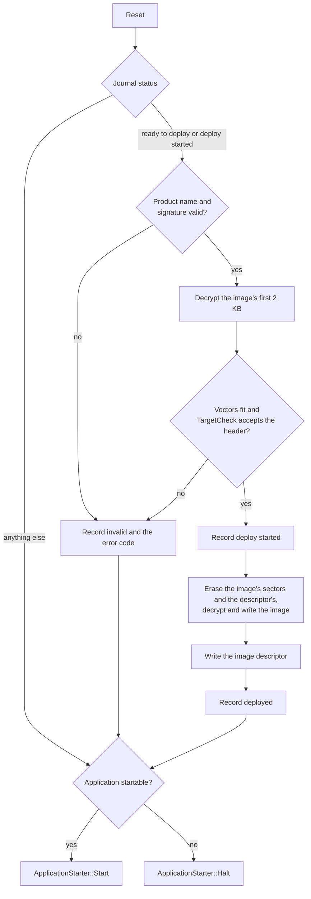

# Bootloader

## Introduction

The `upgrade/boot_loader` package reads an upgrade pack, verifies its signature and hands each image to an image upgrader.
The `bootloader` package builds a single-stage bootloader on top of it: one program at the start of flash that installs a pack staged by the application into the application slot, and starts the application only when the slot holds an intact image built for the chip it runs on.

It adds four things the pack components leave to the product:

- a **status journal**, so the installation's progress survives resets on flash that cannot program a unit twice;
- an **application header** and an **image descriptor**, so an image says what it was built for and the slot proves it is complete;
- an **application installer** that checks the image against the target before anything is erased;
- a **boot sequence** that ties these together at every reset.

Everything is synchronous, uses no heap and no event dispatcher, and runs against `hal::SynchronousFlash`, so the whole install path is tested on the host against a flash fake.

## Boot sequence



- The signature and the target are checked before anything is erased, so a pack that fails either leaves the old application in place.
- An installation interrupted by a reset finds the journal at *deploy started* and starts over; the copy only reads the staging flash, so it can be repeated as often as it takes.
- A flash error during the copy is recorded as *invalid*; the slot is then incomplete and the application is not started.

## Status journal

`bootloader::StatusJournal` keeps the `application::UpgradePackStatus` and error code of the staged pack in a flash region of its own, instead of in the pack's status byte, which the pack loader clears bit by bit and which flash with ECC-protected program units cannot do.

| Offset | Size | Field                                       |
|--------|------|---------------------------------------------|
| 0      | 4    | marker `0x314a4d45` (`EMJ1`)                |
| 4      | 1    | status, as `application::UpgradePackStatus` |
| 5      | 3    | reserved, `0xff`                            |
| 8      | 4    | error code                                  |
| 12     | 4    | check, `~(marker ^ status ^ errorCode)`     |

- Each 16-byte entry goes into the next erased unit; the current status is the last valid entry, and an erased journal reads *empty*.
- An entry a reset cut short fails its check and is skipped, so no unit is ever programmed twice.
- A status and error code equal to the current ones are not written again.
- A full journal is erased and restarted with the status being recorded.

The application starts a download by erasing the journal (`Clear()`), records *downloaded* once the pack passed its checks and *ready to deploy* when the user applies it.
`JournalPackLoader` and `JournalPackUpgrader` replace the status operations of `application::UpgradePackLoader` and `application::PackUpgrader` with the journal.

## Application header and image descriptor

`ImageFormat.hpp` defines what an image carries:

- `TargetLayout`: the chip's RAM and the application slot.
- `ApplicationHeader`: 64 bytes at offset `applicationHeaderOffset` (1 KB) from the start of the image, past the vector table of every supported Cortex-M.

  | Offset | Size | Field                                 |
  |--------|------|---------------------------------------|
  | 0      | 4    | magic `0x48414d45` (`EMAH`)           |
  | 4      | 2    | header version, 1                     |
  | 6      | 2    | reserved, `0xff`                      |
  | 8      | 6    | firmware version: major, minor, patch |
  | 14     | 2    | reserved, `0xff`                      |
  | 16     | 48   | target, defined by the product        |

- `ImageDescriptor`: the last 64 bytes of the slot: magic `0x44494d45` (`EMID`), the image size and the SHA-256 of that many bytes from the start of the slot.

The library never interprets the target area: what an image was built for, a board, a chip family, a device identity or anything else, is the product's to define.
The product describes it as a trivially copyable struct of at most 48 bytes; `MakeApplicationHeader(target, major, minor, patch)` builds the header at compile time with the struct at the start of the target area and the rest erased, so the header comes from the same definitions as the code beside it, and `TargetOf<Target>(header)` reads the struct back.

The product decides whether an image is for this target through `bootloader::TargetCheck`, whose `Accepts(header)` it implements, for example from the chip's identity register read at that moment.
`ExactTargetCheck<Target>` is the common case: it accepts a header whose target equals the one it was given.

```cpp
struct Target
{
    uint16_t board;
    uint16_t family;
    uint32_t device;

    bool operator==(const Target& other) const = default;
};

const bootloader::ExactTargetCheck<Target> targetCheck{ Target{ boardKind, familyTag, ReadDeviceIdentity() } };
```

`ApplicationCheck.hpp` checks an image with it:

- `ImageStartFitsTarget` takes the start of an image: the initial stack pointer lies in RAM, the reset handler is a Thumb address in the slot, the header's magic and version are valid, and the target check accepts the header. Images for chips whose flash or RAM lie elsewhere fail on the vectors alone.
- `ApplicationIsStartable` takes the whole slot: the descriptor is valid, its SHA-256 matches the image, and the image start fits the target.
- `MakeImageDescriptor` computes the descriptor of an image, for tools that program a slot directly.

## Application installer

`bootloader::ApplicationInstaller` is the `application::ImageUpgrader` for the image named `app`. It refuses, before any erase:

| Error code              | Value | When                                                                              |
|-------------------------|-------|-----------------------------------------------------------------------------------|
| `errorWrongDestination` | 1001  | the image's destination is not the start of the slot                              |
| `errorImageSize`        | 1002  | the image is shorter than its header or does not fit the slot less its descriptor |
| `errorWrongTarget`      | 1000  | the decrypted first 2 KB fail `ImageStartFitsTarget`                              |

The values lie outside 0–999, which `UpgradePackHeader.hpp` reserves for the reference boot loaders. AES-128-CTR decrypts any part of the stream on its own, so the target check uses a second decryptor and costs nothing in the copy that follows.
The installer then erases the sectors the image spans and the descriptor's sector, decrypts and writes the image, and writes the descriptor from a SHA-256 of what it reads back from the slot.

## Wiring

The product supplies the flash drivers, the keys, its `TargetCheck` and an `ApplicationStarter`, which jumps to the application or halts:

```cpp
bootloader::StatusJournal journal{ journalFlash };
application::DecryptorAesTiny decryptor{ aesKey };
application::DecryptorAesTiny checkDecryptor{ aesKey };
const application::VerifierEcDsa256 verifier{ publicKey };
std::array<uint8_t, bootloader::imageStartCheckSize> buffer{};

bootloader::ApplicationInstaller installer{ decryptor, checkDecryptor, slotFlash, layout, targetCheck, infra::MakeRange(buffer) };

bootloader::BootSequence{ { packFlash, journal, installer, decryptor, verifier, "product name", slotMemory, layout, targetCheck, starter } }.Run();
```

`slotMemory` is the application slot as memory-mapped bytes, for the check at every reset; `slotFlash` is the same region as a `hal::SynchronousFlash`, with addresses relative to the slot's start.
